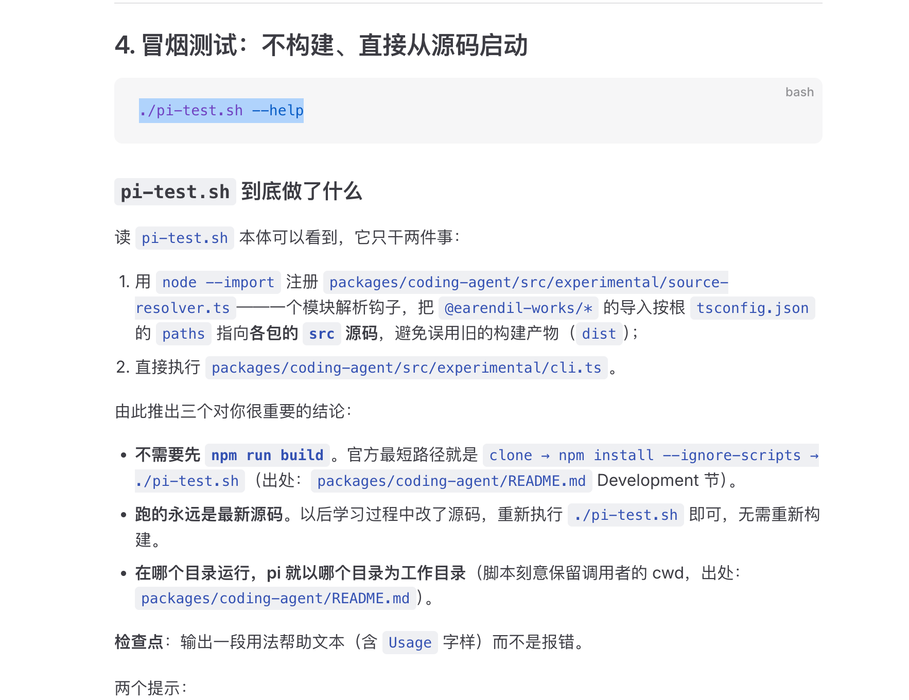
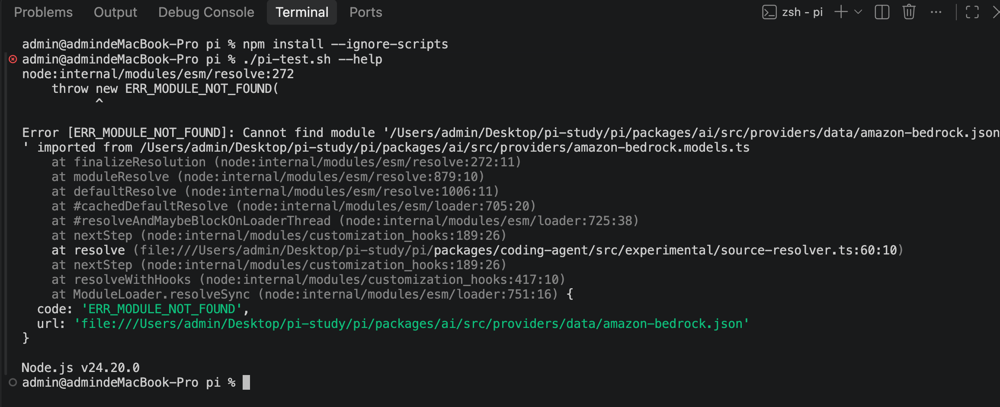

# 01 · 运行 Pi 原始仓库

> **本篇目标**：在你自己的机器上，把 Fork 下来的 Pi 仓库从零跑起来，进入它的终端交互界面，并完成第一次模型登录。
>
> **方式**：所有命令由你**手动执行**。每一步都有预期结果和检查点；出错就把「你执行的完整命令 + 完整输出（含报错）」截图发给 AI，由 AI 帮你定位。
>
> **出处**：本文命令均来自仓库官方文档——根目录 `README.md` 的 Development 一节、`packages/coding-agent/README.md` 的 Development 一节，以及 `pi-test.sh`、`docs/`（`packages/coding-agent/docs/`）中的说明。文中注明了每条关键内容的来源，方便你对照原文。

---

## 1. 检查环境

Pi 对 Node.js 有硬性要求（出处：`packages/coding-agent/package.json` 的 `engines.node` 字段）：**Node ≥ 22.19**。

为什么是这个版本：`pi-test.sh` 直接运行 TypeScript 源码，Node 22.x 起原生支持「剥离类型直接跑 `.ts`」，不再需要先编译（出处：`packages/coding-agent/src/experimental/source-resolver.ts` 的注释）。版本太低会在启动时直接报错。

```bash
node --version
npm --version
git --version
```

**检查点**：`node --version` 输出 `v22.19.0` 或更高。

- 写这篇文档时，你的机器是 Node `v24.20.0`（nvm 安装），已满足。
- 如果版本不够且你用 nvm：`nvm install 22 && nvm use 22`。

---

## 2. 进入仓库，确认状态

按工作区约定（工作区根目录 `AGENTS.md` 的分支模型），**运行实验在 main 分支上做**，暂不切换学习分支。

```bash
cd /Users/admin/Desktop/pi-study/pi
git status
git branch
```

**检查点**：
- 当前在 `main` 分支，working tree clean；
- 分支列表里有 `main` 和 `pi-1006-2026`。

---

## 3. 安装依赖

```bash
npm install --ignore-scripts
```

- **出处**：根 `README.md` Development 节的官方命令。
- **为什么带 `--ignore-scripts`**：只下载依赖包，不执行第三方包的安装脚本（生命周期脚本）。Pi 出于供应链安全统一这样装（出处：`pi/AGENTS.md` 的 Dependency and Install Security 一节）。副作用是根目录 `package.json` 里的 `prepare: husky` 也不会执行——不影响后续运行。
- **预期**：命令结束不报错，`pi/` 下出现 `node_modules/`，输出末尾形如 `added N packages`。
- **耗时**：这是个 monorepo，首次安装要几分钟，属正常。

**检查点**：命令退出码为 0，没有任何 `ERR!`。

---

## 4. 冒烟测试：不构建、直接从源码启动

```bash
./pi-test.sh --help
```

### `pi-test.sh` 到底做了什么

读 `pi-test.sh` 本体可以看到，它只干两件事：

1. 用 `node --import` 注册 `packages/coding-agent/src/experimental/source-resolver.ts`——一个模块解析钩子，把 `@earendil-works/*` 的导入按根 `tsconfig.json` 的 `paths` 指向**各包的 `src` 源码**，避免误用旧的构建产物（`dist`）；
2. 直接执行 `packages/coding-agent/src/cli.ts`。

由此推出三个对你很重要的结论：

- **不需要先 `npm run build`**。官方最短路径就是 `clone → npm install --ignore-scripts → ./pi-test.sh`（出处：`packages/coding-agent/README.md` Development 节）。
- **跑的永远是最新源码**。以后学习过程中改了源码，重新执行 `./pi-test.sh` 即可，无需重新构建。
- **在哪个目录运行，pi 就以哪个目录为工作目录**（脚本刻意保留调用者的 cwd，出处：`packages/coding-agent/README.md`）。

**检查点**：输出一段用法帮助文本（含 `Usage` 字样）而不是报错。如果报 `ERR_MODULE_NOT_FOUND`，见下方「踩坑实录」。

两个提示：
- Pi **支持** `--version`（或 `-v`），可以顺手验证：`./pi-test.sh --version` 应输出版本号（出处：`src/cli/args.ts`）。
- 如果这一步直接进入了全屏交互界面，说明运行更成功——按 `Ctrl+D`（编辑器为空时）或连按 `Ctrl+C` 退出即可。

Windows 用户改用 `pi-test.ps1`（PowerShell）或 `pi-test.bat`。

### 踩坑实录（2026-10-06）：`ERR_MODULE_NOT_FOUND`——缺模型数据文件

**现象**：按上面的步骤执行，`npm install --ignore-scripts` 成功，但 `./pi-test.sh --help` 直接崩溃退出。

出错时的本节文档状态：



终端报错截图：



报错关键行：

```text
Error [ERR_MODULE_NOT_FOUND]: Cannot find module
  '/Users/admin/Desktop/pi-study/pi/packages/ai/src/providers/data/amazon-bedrock.json'
  imported from .../packages/ai/src/providers/amazon-bedrock.models.ts
  code: 'ERR_MODULE_NOT_FOUND',
Node.js v24.20.0
```

**根因**（读仓库源码确认，不是猜测）：

1. `.gitignore` 第 11 行明确写着 `packages/ai/src/providers/data/`——这个目录**被有意排除在 git 之外**，它不是仓库的一部分，而是本地产物。全新 clone 之后它根本不存在（可用 `git ls-files packages/ai/src/providers/data/` 验证：输出为空）。
2. 已提交的 `packages/ai/src/providers/*.models.ts`（文件头写着 auto-generated）在**模块顶层**就 `import values from "./data/amazon-bedrock.json" with { type: "json" }`。
3. `./pi-test.sh` 启动时会加载整个 provider 注册表，这个 import 在模块加载阶段就会执行——数据目录缺失，直接崩。

**为什么官方命令没帮你避开**：根 `README.md` 的 `npm run build` 注释是「Refresh model data, then build all packages」——`packages/ai` 的 `build` = `generate-models && build:offline`，走 build 的人会先生成数据。而 coding-agent README 给的最短路径（install → `./pi-test.sh`）在**全新 clone** 上就会撞到这个坑。

**解决方法**：执行一次模型数据水合（hydrate）命令：

```bash
npm run hydrate:model-data
```

- **出处**：根 `package.json` 的 scripts → `npm --prefix packages/ai run hydrate-model-data` → `node scripts/generate-models.ts --strict --data-only`。
- **作用**：从网络拉取模型元数据（`https://models.dev/api.json`、OpenRouter 等），**只**写 `packages/ai/src/providers/data/*.json`。`--data-only` 表示不重新生成任何已提交的源码文件（如 `models.generated.ts`），改的全是 gitignore 的本地数据。
- **成功标志**：命令结束时输出 `Hydrated JSON model values under src/providers/data/`。

**验证修复**：

```bash
ls packages/ai/src/providers/data/     # 应能看到 amazon-bedrock.json、openai.json 等
./pi-test.sh --help                    # 这次应输出 Usage 帮助文本
```

**这是一次性操作**：`data/` 只是被 gitignore，生成一次后一直存在，之后照常 `./pi-test.sh` 即可。只有删除了该目录、或上游更新了 provider 数据想刷新时，才需要重跑。

**如果 `hydrate:model-data` 本身报错**：

- 它带 `--strict` 标志：任何必需数据源拉取失败都会**直接抛错退出**（而不是降级警告）。最常见的就是网络不通——确认本机能访问 `https://models.dev/api.json`（浏览器直接打开试一下）；需要代理就先 `export HTTPS_PROXY=http://127.0.0.1:7890`（按你的代理端口改）再重试。
- **不要用 `npm run build:offline` 兜底**：它假定 `data/` 已存在（先跑 `check:model-data`），全新检出必然失败。

---

## 5. 正式启动，完成首次登录

```bash
./pi-test.sh
```

界面结构（出处：`packages/coding-agent/docs/quickstart.md`）：
- 上方：对话区
- 中间：提示词输入编辑器
- 底部：状态栏，显示当前工作目录、模型、会话状态

刚启动时还没有任何模型可用，先完成登录：

1. **登录**：输入 `/login` 回车 → 选择 provider → 按提示完成订阅授权或粘贴 API key。凭据保存在 `~/.pi/agent/auth.json`（出处：`docs/models.md` Authenticate 一节）。
2. **选模型**：`/model` 搜索并选择模型；`/thinking` 选择推理档位（在列表里按 `Ctrl+S` 可存为默认）。
3. **发第一条消息**测试，例如：`这个目录是做什么的？`

**不用 `/login` 的替代方案**：通过环境变量提供 API key，例如 `ANTHROPIC_API_KEY`、`OPENAI_API_KEY`，变量清单见 `packages/coding-agent/docs/providers.md`。凭据优先级是：运行时 `--api-key` → `auth.json` → `models.json` 里的 `apiKey` → 环境变量（出处：`docs/models.md`）。

### 基础操作速查（出处：`docs/usage.md`、`docs/keybindings.md`）

| 操作 | 按键 / 命令 |
|---|---|
| 发送消息 | `Enter` |
| 换行 | `Shift+Enter`；或 `Ctrl+G` 打开外部编辑器 |
| 展开 / 收起工具输出 | `Ctrl+O` |
| 显示 / 隐藏思考过程 | `Ctrl+T` |
| 切换模型 | `Ctrl+L` 或 `/model` |
| 复制上一条回复 | `Ctrl+X` 或 `/copy` |
| 导出会话 | `/export` |
| 退出 | 编辑器为空时 `Ctrl+D`；或连按 `Ctrl+C`（第一次清空输入，第二次退出） |

::: warning 安全提示
Pi **没有内置权限系统**：`bash`、写文件等工具调用默认**直接执行**，不会逐个征求你同意（出处：根 `README.md` Permissions & Containerization 一节）。学习阶段请在测试目录里运行 Pi，不要直接对重要仓库放开。
:::

---

## 6. 验收清单

- [ ] `node --version` ≥ v22.19
- [ ] `npm install --ignore-scripts` 无报错
- [ ] （仅全新检出）`npm run hydrate:model-data` 生成模型数据，见第 4 节踩坑实录
- [ ] `./pi-test.sh --help` 输出帮助文本
- [ ] `./pi-test.sh` 进入交互界面，底部状态栏正常显示
- [ ] `/login` 完成，发出第一条消息并收到模型回复

全部打勾，本篇完成。

任何一步失败：记下**你执行的完整命令 + 完整输出（含报错）**，截图发给 AI 处理。

---

## 7. 附录 A：官方开发命令速查

出处：根 `README.md` Development 节。

| 命令 | 作用 |
|---|---|
| `npm install --ignore-scripts` | 安装全部依赖，不执行生命周期脚本 |
| `./pi-test.sh` | 从**源码**启动 pi（可在任意目录运行） |
| `npm run build` | 刷新模型数据，然后构建全部包 |
| `npm run build:offline` | 不联网，用现有模型数据重建 |
| `npm run check` | Lint + 格式化 + 类型检查 |
| `./test.sh` | 跑测试；在隔离的临时 HOME 里执行，没配 API key 时自动跳过依赖 LLM 的测试 |

补充两条 `pi/AGENTS.md` 里的规则（它们约束的是「AI 代你操作」的场景，你手动执行不受限）：

- 改完代码后跑 `npm run check`；
- 未经你明确要求，AI 不应主动运行 `npm run build` 或 `npm test`。

---

## 8. 附录 B：常见报错排查表

| 现象 | 原因 | 处理 |
|---|---|---|
| `./pi-test.sh` 报 `ERR_MODULE_NOT_FOUND: ... providers/data/xxx.json` | 模型数据目录被 gitignore，全新检出没有本地生成 | `npm run hydrate:model-data`，详见第 4 节踩坑实录 |
| `hydrate:model-data` 报 fetch 失败 / models.dev 相关错误 | `--strict` 模式下网络拉取失败 | 检查网络/代理（`HTTPS_PROXY`）后重试 |
| 运行 `.ts` 报语法错，或 `node: bad option` | Node 版本 < 22.19 | `nvm install 22 && nvm use 22`，确认 `node --version` |
| `npm install` 网络超时 / `ECONNREFUSED` | 网络或 registry 不可达 | 可临时换镜像：`npm config set registry https://registry.npmmirror.com`，装完可换回 |
| `npm ERR! EACCES` 权限报错 | npm 全局目录权限问题 | 你在用 nvm 管理 Node，一般不会遇到；**不要用 `sudo`** |
| `./pi-test.sh: Permission denied` | 检出后丢了执行权限 | `chmod +x pi-test.sh` |
| 启动后提示需要登录 / 找不到 provider | 尚未配置模型 | 正常现象，执行 `/login` |
| 界面乱码 / 显示错位 | 终端兼容性 | 换 Terminal.app / iTerm2，或见 `packages/coding-agent/docs/terminal-setup.md` |
| `npm install` 报某个包 `postinstall` 相关错误 | 不应发生（`--ignore-scripts` 已禁用脚本） | 确认命令没漏 `--ignore-scripts`；仍报错则截图给 AI |

---

## 下一步

跑通之后，下一篇开始**全景梳理**：Pi 有哪些功能、怎么运行、功能点地图是什么——为「最小粒度重新搭建」制定路线图。
